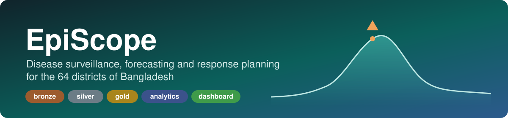

<p align="center"></p>

# EpiScope

Big data surveillance, forecasting and response-planning platform (CSE 4345 CEP, Spring 2026).

**Group Sentinel BD:** Nishadul Islam Shezan, Tahsin Ahmed Rafi, Rimjhim Dey, Samira Sultana.

| | |
|---|---|
| **Video** | https://youtu.be/8HprXP6ck6w |
| **Slides** | https://shinzuu.github.io/episcope-video/ |
| **Report** | [`docs/EpiScope-report.pdf`](docs/EpiScope-report.pdf) (IEEE format, policy brief in Appendix A) |

## Prerequisites

- Linux or macOS, 16 GB RAM, about 15 GB free disk for SF=1 (about 4 GB for SF=0.25, including the 1 GB Python environment).
- [mise](https://mise.jdx.dev) (installs Java 17 and Python 3.12 from `mise.toml`), `make`, `git`.
- Node is needed only to rebuild the TopoJSON map (`npx mapshaper`); the built map is committed.
- No account or API key. The processed public reference data is committed in `data/reference/`.
- No Docker: `mise.toml` pins Java and Python and `requirements.txt` pins every direct Python dependency, which is
  lighter on a 16 GB laptop than a Spark container. A machine with Docker can still run the same commands in a
  plain Python 3.12 + Java 17 image.
- If `/tmp` is a small RAM disk, set `EPISCOPE_SPARK_LOCAL_DIR` in `.env` to a disk folder (SF=1 spills there).

## Run

```bash
make setup          # Java 17 + Python 3.12 via mise, pinned deps, .env with a random salt
make all SF=0.25    # DAG with retries (scripts/dag.py): reference -> generate -> bronze -> silver -> gold -> analytics -> serve, catalog
make evaluate       # detection scored against the injected outbreaks (the only reader of ground_truth/)
make calendar-check # calendar onset against each year's observed onset (calendar_check.json)
make dashboard      # http://localhost:8000
make check          # five verification gates (scripts/verify.py)
```

Result files (backtest, allocation, calendar, SEIR, calendar check) go to `data/results/`, so a build does not
replace the committed SF=1 results in `docs/experiments/` that the report cites. To write there on purpose, run
`EPISCOPE_RESULTS_DIR=docs/experiments make all SF=1`; `git checkout -- docs/experiments` restores the committed
files. The per-cell backtest scores (`data/evaluation/backtest_scores.csv`) hold unsuppressed district-week
counts and are never committed.

`SF=1` gives the full 25M+ encounters. `make test` runs the unit tests (about 35 minutes on a laptop).

## Hidden test drop

Put the drop's files under `data/raw/` in the same layout as the generator
(`encounters/report_date=YYYY-MM-DD/*.csv`, `stock/snapshot_date=YYYY-MM-DD/*.json`), then run:

```bash
make bronze silver gold analytics serve   # loads only files not seen before, rebuilds the changed weeks
```

Nothing names a date, file or row count: files are found by glob and checksum, so the same command handles any
drop. Running it twice changes nothing. To rehearse with a drop of our own: `make drop SF=<base SF> DROP_SEED=1234` writes a
fresh 14-day drop after the last date in `data/raw/`; `scripts/hidden_drop_drill.sh` does the whole test from a
clean clone and writes `docs/experiments/hidden_drop_drill.json`.

District view (PRV-3): `make serve` also writes one bundle per district to `dashboard/roles/<code>/`; open
`http://localhost:8000/?district=BD1004` to see Barguna in detail and every other area only as a division total.
The bundles decide what each role is sent; stopping a district user from fetching `data/` needs server-side
access control, which a static server does not have.

Other entry points: `make stream` keeps a Structured Streaming job running that refreshes the alerts when new
encounter files land (ING-6); `make asof DATE=2025-06-30` shows gold as it was known on that date (ING-7).

## Architecture

```
public data (HDX boundaries and population, Open-Meteo weather) --+
synthetic generator (encounters S4, facilities S5, stock S6) -----+--> bronze: files as written + checksum,
                                                                       batch ID, load time (Delta, by batch_id)
  --> silver: 28 quality rules, quarantine with reason codes, HMAC patient key, Delta MERGE on encounter_id
  --> gold: district x disease x onset week, lineage batch_ids, dq_report (Delta, by epi_year)
  --> analytics: EARS C2 + CUSUM alerts, NB-GLM forecasts + backtest, demand, LP allocation, STL calendar
  --> serving: aggregated JSON, counts 1-4 suppressed with complementary suppression, <= 10 MB
  --> dashboard: D3.js v7, five linked views and a what-if panel
```

Spark 4.0.1 in local mode with Delta Lake 4.0.1; one Makefile drives every stage; tables are registered in a
Hive catalog (`make catalog`). Details and the reasons for each choice are in the report.

## Requirement traceability

| ID | File | Report section |
|---|---|---|
| ING-1 | generator/generate.py, pipeline/reference/, pipeline/bronze/ingest.py | §4 |
| ING-2 | pipeline/silver/build.py | §4 |
| ING-3 | pipeline/gold/build.py, pipeline/catalog.py | §3 |
| ING-4 | pipeline/silver/build.py | §4 |
| ING-5 | not done: local filesystem on purpose, to save RAM | §3, §9 |
| ING-6 | pipeline/stream.py | §3, §4 |
| ING-7 | pipeline/gold/asof.py | §4 |
| DQ-1 | pipeline/quality/rules.py | §4 |
| DQ-2 | pipeline/quality/engine.py | §4 |
| DQ-3 | pipeline/quality/engine.py | §4 |
| DQ-4 | pipeline/silver/dedup.py | §4 |
| PRV-1 | pipeline/privacy/deid.py | §4 |
| PRV-2 | pipeline/privacy/suppression.py | §4 |
| PRV-3 | serving/roles.py, dashboard/js/data.js (`?district=`) | §7, §8 |
| PRV-4 | pipeline/privacy/kanon.py | §8 |
| AN-1 | analytics/detection/methods.py | §5 |
| AN-2 | analytics/evaluation/run.py | §6 |
| AN-3 | analytics/detection/prepare.py | §5, §6 |
| AN-4 | analytics/forecast/forecast.py | §5 |
| AN-5 | analytics/forecast/backtest.py | §6 |
| AN-6 | analytics/forecast/demand.py | §5 |
| AN-7 | analytics/optimise/lp.py | §5 |
| AN-8 | analytics/optimise/curve.py | §6 |
| AN-9 | analytics/calendar/stl_calendar.py, analytics/calendar/check.py | §5, §6 |
| AN-10 | analytics/scenario/seir.py | §5, §6 |
| VIS-1 | dashboard/index.html | §7 |
| VIS-2 | dashboard/js/views/ | §7 |
| VIS-3 | dashboard/js/state.js | §7 |
| VIS-4 | serving/export.py | §7 |
| VIS-5 | dashboard/js/views/allocation.js | §7 |
| VIS-6 | dashboard/css/style.css | §7 |
| VIS-7 | dashboard/css/style.css | §7 |
| ENG-1 | Makefile | §3 |
| ENG-2 | scripts/scaling.sh | §6 |
| ENG-3 | pipeline/quality/engine.py, analytics/forecast/backtest.py, docs/experiments/silver_optimisation.json, docs/experiments/backtest_optimisation.json | §6 |
| ENG-4 | tests/, scripts/dag.py (DAG with retries) | §3 |

## Data sources

- Boundaries and population: BBS / OCHA ROAP via HDX COD-AB and COD-PS (CC BY-IGO).
- Weather: Open-Meteo historical archive (ERA5), Zippenfenig 2023 (CC BY 4.0).
- Patient encounters, facilities and stock: **synthetic**, generated by `generator/` (no real patient data).
- Processed reference files are committed in `data/reference/`. The TopoJSON map build needs Node (`npx mapshaper`).

## Docs

- `docs/proposal.md`: M1 proposal
- `docs/EpiScope-report.pdf`: the technical report (IEEE format), with the policy brief in Appendix A
- `docs/FINAL-NUMBERS.md`: every headline number and the result file it comes from
- `docs/contracts.md`: data contracts between components (tables, exports, role bundles)
- `AI_USAGE.md`: where AI tools were used, as the brief requires
- `docs/research.md`: primary-source research for every method, dataset and tool
- `generator/schema.json`: schema contract for S4–S6
